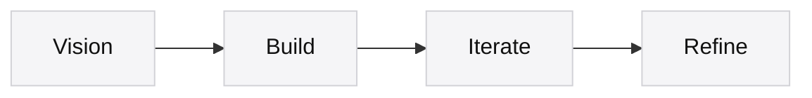

# Nam Trần

> *Ideas deserve craftsmanship.*

I explore technology through clarity, curiosity, and purpose.

Every project begins with a vision.  
AI extends my ability to build, iterate, and refine ideas.

I believe that great software is not measured by complexity, but by the simplicity it leaves behind.

---

**Website**  
[tranvohoangnam.id.vn](https://tranvohoangnam.id.vn) · [namtran.ddns.net](https://namtran.ddns.net)

---

## Process

## Toolbox

  
  
  
  
  
  
  
  
  
  

**English** · [Tiếng Việt](README.vi.md)

