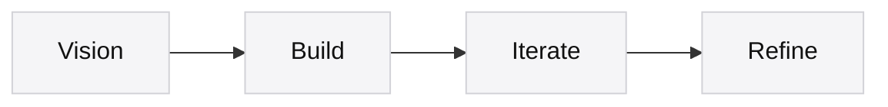
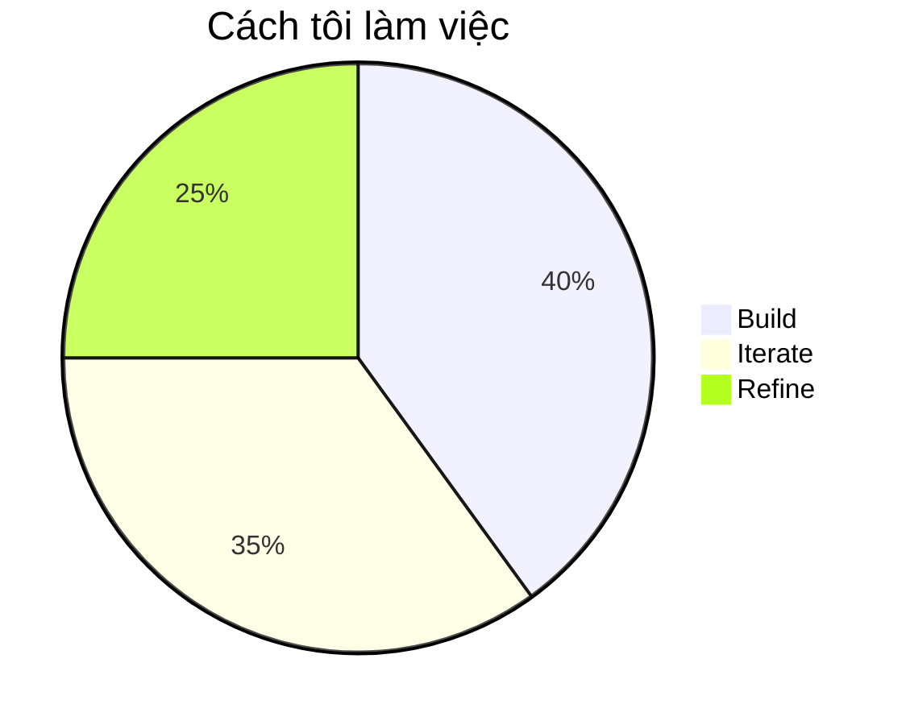

# Nam Trần

> *Ý tưởng xứng đáng với sự tỉ mỉ.*

Tôi khám phá công nghệ thông qua sự rõ ràng, tò mò và mục đích.

Mọi dự án đều bắt đầu từ một tầm nhìn.  
AI mở rộng khả năng của tôi để xây dựng, lặp lại và hoàn thiện ý tưởng.

Tôi tin rằng phần mềm vĩ đại không được đo bằng độ phức tạp, mà bằng sự đơn giản mà nó để lại phía sau.

---

**Website**  
[tranvohoangnam.id.vn](https://tranvohoangnam.id.vn) · [namtran.ddns.net](https://namtran.ddns.net)

---

## Quy trình

## Trọng tâm

## Công cụ

  
  
  
  
  
  
  
  
  
  

[English](README.md) · **Tiếng Việt**

